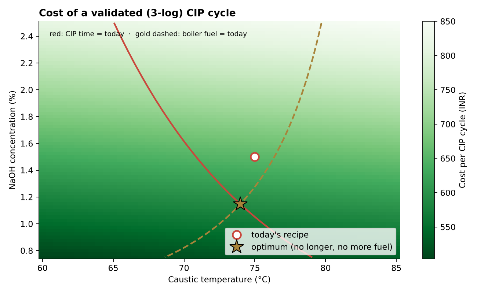
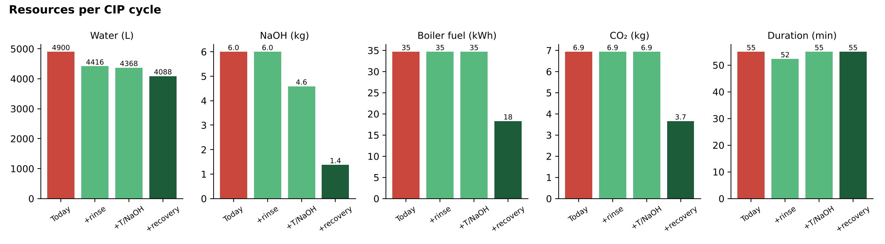
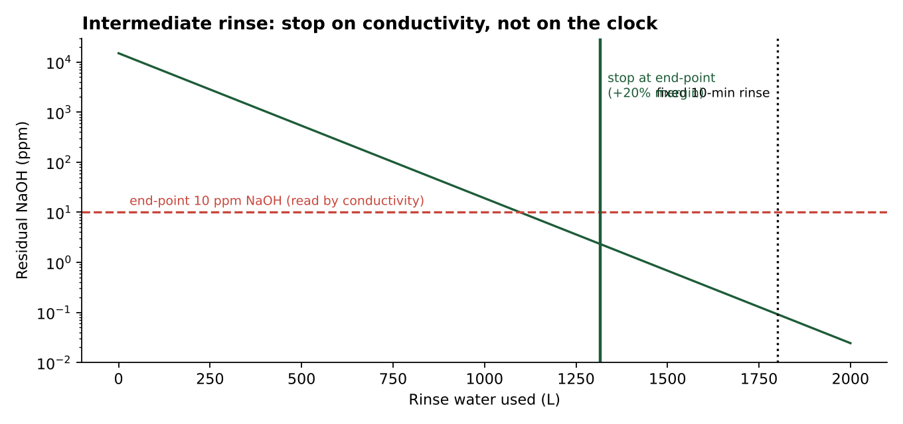

# CIP Optimiser: clean a filling line to spec with less water, caustic and energy

**A chemical-engineering model of clean-in-place (CIP) that finds the cheapest validated recipe and shows where water, NaOH and boiler fuel are wasted.**

Every product-family changeover on a filling line ends in a CIP cycle: pre-rinse, hot caustic wash, intermediate rinse, final rinse. Plants usually run fixed recipes ("75 °C, 1.5 % NaOH, 30 min, rinse 10 min") that over-clean and over-rinse to be safe. This project models the cleaning kinetics, rinsing and heat balance, then optimises the recipe under two constraints: the soil must still be removed to a 3-log (99.9 %) standard, and CIP must not take longer or burn more fuel than today.

> All parameters are **assumptions** in a typical range for a small cosmetics filling circuit (listed in `cipopt/model.py`). The model structure and optimiser are real; the numbers become plant numbers once the parameters are fitted to swab/ATP results, conductivity traces and steam readings.



## Results (per line)

| Per CIP cycle | Duration | Water | NaOH | Boiler fuel | CO₂ | Cost | Soil reduction |
|---|---|---|---|---|---|---|---|
| Today (fixed-time recipe) | 55 min | 4,900 L | 6.0 kg | 34.7 kWh | 6.9 kg | ₹685 | 3.9-log |
| + rinse to conductivity end-point | 52 min | 4,416 L | 6.0 kg | 34.7 kWh | 6.9 kg | ₹656 | 3.9-log |
| + optimised temperature and NaOH (74 °C, 1.15 %, 33 min) | 55 min | 4,368 L | 4.6 kg | 34.7 kWh | 6.9 kg | ₹590 | 3.6-log |
| **+ caustic recovery tank** | **55 min** | **4,088 L** | **1.4 kg** | **18.3 kWh** | **3.7 kg** | **₹371** | **3.6-log** |

Per cycle: **−17 % water, −77 % NaOH, −47 % boiler fuel and CO₂, −46 % cost**, with the same CIP duration and the 3-log cleaning standard still met (with a 20 % safety margin on wash time and rinse volume).



**Per line per year** at 324 CIP cycles (one per product-family change, from the ChangeoverIQ study): about **263 m³ of water, 1.5 t of NaOH, 5.3 MWh of boiler fuel, 1.1 t CO₂ and ₹1.0 lakh** saved. Combined with ChangeoverIQ's optimised sequencing, which cuts family changes to 132 a year, the saving rises to about **1,048 m³ of water, 1.8 t NaOH, 1.8 t CO₂ and ₹1.7 lakh** per line per year.



## How it works

- **Cleaning kinetics.** Soil removal in the caustic step is first order, residual = e^(−kt), with k following Arrhenius in temperature (Eₐ = 40 kJ/mol) and a power law in NaOH concentration (order 0.5). The wash time is set to reach 3-log × 1.2.
- **Rinsing.** The circuit behaves as a well-mixed hold-up V (150 L), so residual caustic falls as C₀·e^(−V_rinse/V). Stopping on a conductivity end-point (10 ppm NaOH, +20 % margin) instead of a fixed 10 minutes saves about 480 L per cycle.
- **Heat balance.** The caustic charge is heated from ambient (or from 55 °C when recovered), plus heat loss UA·ΔT while held; boiler efficiency 85 %.
- **Recovery.** With a recovery tank the caustic is reused for 5 cycles with 10 % top-up, so most NaOH, make-up water and heating are not repeated every cycle.
- **Optimisation.** Cost per cycle (water + effluent, NaOH, fuel) is minimised over temperature (60–85 °C) and concentration (0.75–2.5 %) with SLSQP, subject to duration ≤ today and fuel ≤ today; a 51 × 71 grid search confirms the optimum (₹590 both ways).
- **Trade-off.** `figures/pareto_water_energy.png` shows how hotter cleaning saves water and caustic but costs fuel.

## Run it

```bash
pip install -r requirements.txt
python run_analysis.py      # results.json + figures/ (~2 s)
pytest -q                   # 5 tests
streamlit run app.py        # move temperature and NaOH, see water, caustic, fuel and cost react
```

## Limitations

- Kinetic constants and the 3-log target are assumptions; real soils (silicones, waxes, pigments) need swab or ATP validation of every recipe before any change is made.
- Only the intermediate rinse is moved to an end-point; the final rinse is left at a fixed time as a conservative choice.
- Caustic recovery needs a tank, concentration control and periodic dumping. Its capital cost is not modelled.
- Water cost includes effluent treatment at a single assumed rate.

*Author: Pravin Kumar Mahato, B.Tech Chemical Engineering, BIT Mesra.*
